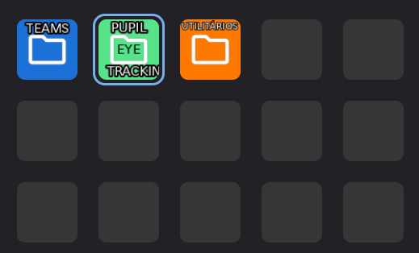
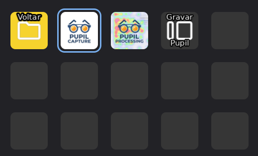
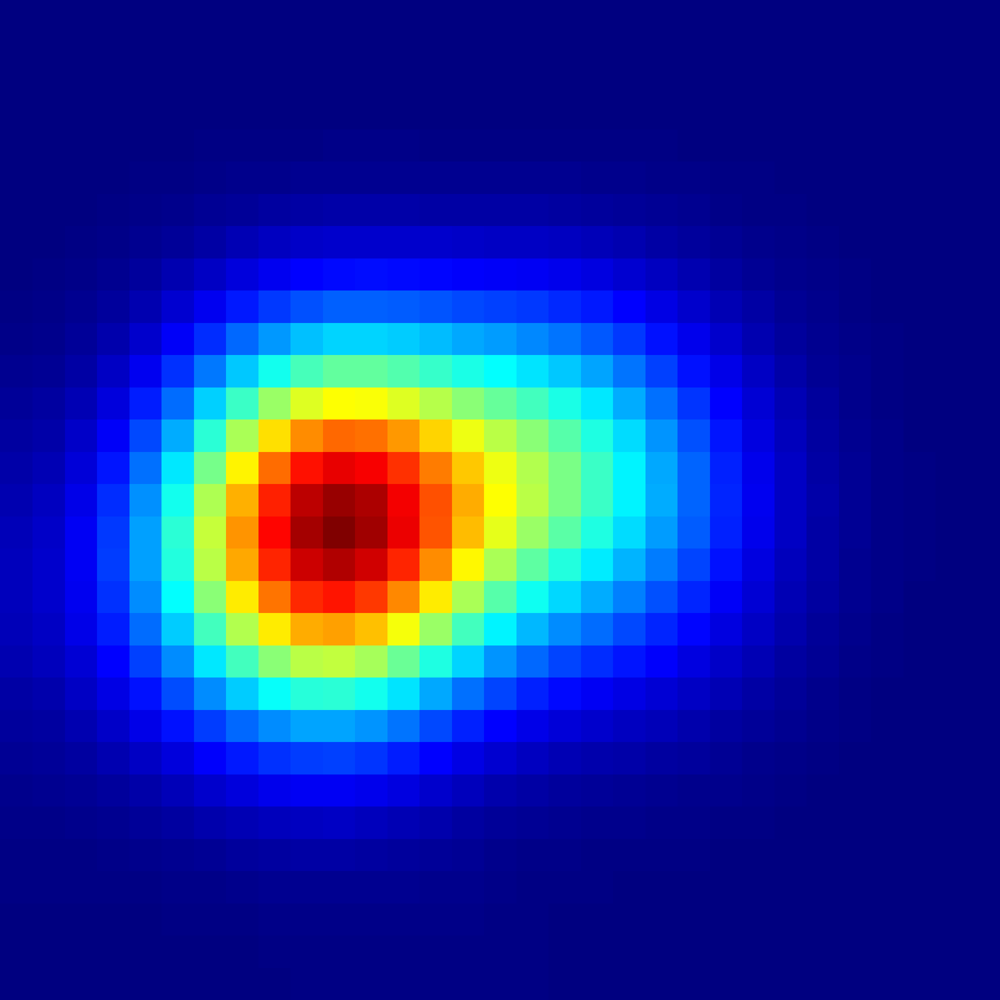
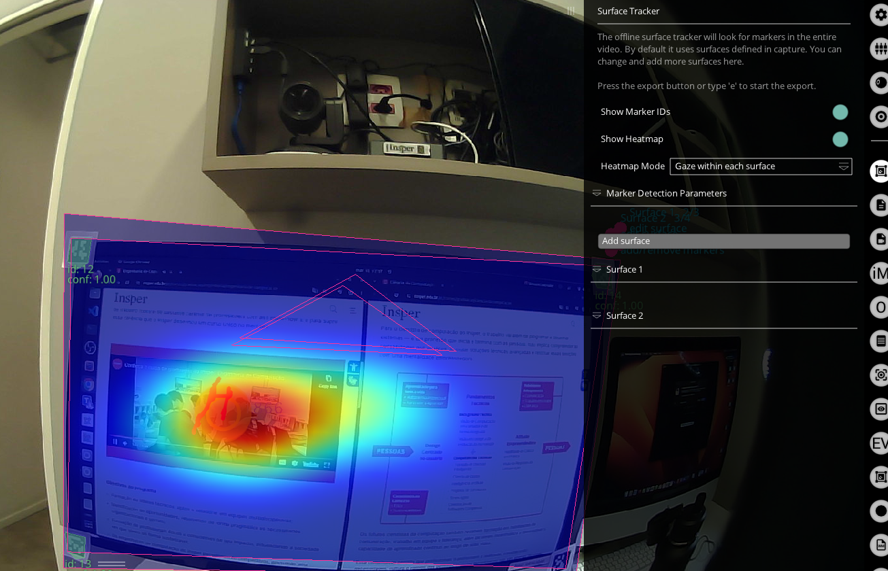

# ⚠️ Aviso

> É obrigatório que HAJA UM TÉCNICO acompanhando diretamente o uso da sala de usabilidade. Não operar os equipamentos sem supervisão técnica.

# Pupil Core

Imagem do Pupil Core (fonte: Pupil Labs). Mais detalhes: https://pupil-labs.com/products/core/

## Configuração e captura

1. No Stream Deck, abra a pasta "Pupil Eye Tracking" (ícone verde) e clique em `Pupil Capture`.

	

	

2. O Pupil Capture será aberto. No painel direito, confirme que a extensão "Surface Tracker" está ativada:

	

3. Em `Marker Type`, selecione exatamente `Apriltag (tag36h11)` — essa opção é necessária para reconhecer os marcadores (QR codes) no monitor.

4. Faça a calibração dos óculos. A calibração deve ser realizada apenas pelo técnico responsável; se ele não estiver disponível, solicite auxílio antes de prosseguir.

5. Execute as etapas de calibração e gravação na ordem indicada (de cima para baixo):

	

6. Durante a gravação é possível adicionar "surfaces" (áreas mapeadas) clicando no atalho `S`. Surfaces permitem gerar mapas de calor (heatmaps) por área de interesse:

	

Dica: adicione surfaces correspondentes a páginas ou telas diferentes quando testar um aplicativo ou site com várias vistas.

## Visualizando resultados no Pupil Player

1. Abra o arquivo de gravação no `Pupil Player`.

2. No painel do Surface Tracker, habilite `Show Marker IDs` e `Show Heatmap` para visualizar identificadores de marcador e mapas de calor:

	

3. Para a gravação final, o técnico deve reproduzir o vídeo no Pupil Player e, simultaneamente, acionar o botão "Gravar Pupil" no dispositivo até o fim do vídeo. Isso garante que os dados do eye tracker e o vídeo fiquem sincronizados.

Agora o técnico irá iniciar a gravação final, o resultado final do processo de eye tracking, para isto ele deverá dar play no vídeo dentro do Pupil Player e ao mesmo tempo clicar no ícone "Gravar Pupil" do Eye tracker, até o vídeo acabar no Pupil Player.

## Produto final

A seguir está um exemplo de um frame de um vídeo de teste de usabilidade utilizando o Pupil Core:

