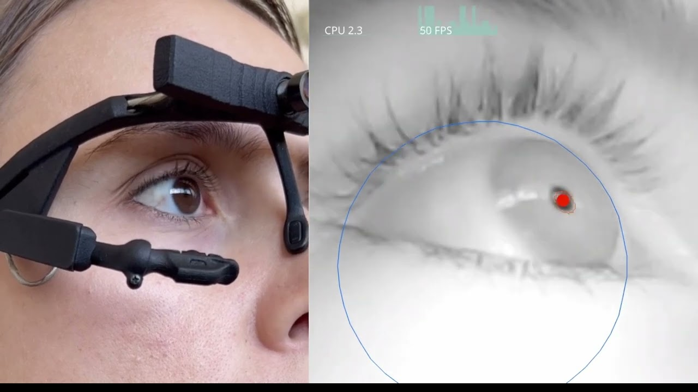
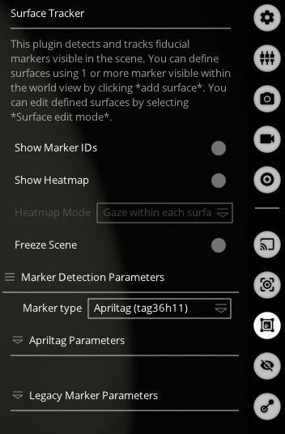
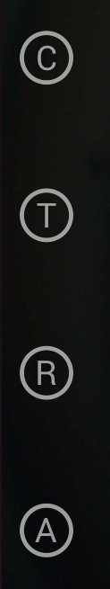
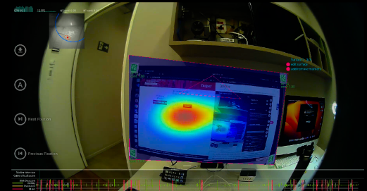

# Pupil Core

O Pupil Core é um rastreador ocular vestível que registra o campo de visão do participante e estima a direção do olhar. Este guia apresenta o fluxo de preparação, calibração, captura e análise utilizado na Sala de Usabilidade.

> **Supervisão técnica obrigatória:** o uso dos equipamentos deve ser acompanhado diretamente por um técnico. A calibração deve ser conduzida pelo técnico responsável.

Antes da atividade, consulte as [orientações gerais e o procedimento de agendamento](../orientacoes-gerais.md). Combine com a equipe os cuidados com participantes, gravações e armazenamento dos arquivos.

*Imagem do equipamento: Pupil Labs.*

## Entenda o fluxo

- **Pupil Capture:** recebe as imagens das câmeras, permite calibrar o rastreamento e grava a sessão.
- **Pupil Player:** abre a sessão gravada para análise, visualização e exportação.
- **Surface Tracker:** identifica superfícies planas, como um monitor, por meio de marcadores visuais e relaciona os pontos do olhar a essas superfícies.

As imagens mostram a configuração documentada do laboratório. A disposição dos menus e os atalhos do Stream Deck podem variar; confirme a configuração disponível com o técnico.

## Preparação e abertura do Pupil Capture

1. Com o técnico, confira a conexão do equipamento, o ajuste dos óculos e o conforto do participante.
2. No Stream Deck, abra a pasta **Pupil Eye Tracking**, identificada pelo ícone verde.

   

3. Selecione **Pupil Capture**.

   

4. Confirme que as janelas das câmeras mostram o ambiente e os olhos. Se alguma imagem não aparecer, solicite a verificação do técnico antes de continuar.
5. No painel de plugins, habilite **Surface Tracker** quando a atividade exigir análise de uma superfície.

   

6. Para os marcadores mostrados na configuração deste guia, selecione **Apriltag (tag36h11)** em **Marker Type**. A família selecionada deve corresponder aos marcadores utilizados. Esses marcadores são **AprilTags**, e não QR codes.

## Calibração e validação

Antes de calibrar, o técnico deve conferir a detecção das pupilas, o foco da câmera do ambiente e o enquadramento da área utilizada no teste.

1. O técnico seleciona o método de calibração e inicia o procedimento pelo controle **C**.
2. O participante segue os alvos conforme as instruções do método escolhido.
3. Após a calibração, o técnico utiliza o controle **T** para validar a estimativa do olhar.
4. Se a validação indicar problemas, o técnico ajusta o equipamento e repete o procedimento antes da captura.

## Definição das superfícies

Com o **Surface Tracker** ativo, enquadre os marcadores e use **Add surface** ou o controle **A** para adicionar uma superfície. A documentação atual indica o atalho de teclado `a`. Dê um nome à superfície e ajuste seus cantos para delimitar a área desejada.

As superfícies podem ser definidas no Capture ou posteriormente no Player, desde que os marcadores estejam visíveis na gravação. Mantenha-os no mesmo plano da superfície e sem obstruções.

Uma superfície representa uma área física rastreada, como o monitor. Ao alternar entre páginas de um site no mesmo monitor, separe os trechos da gravação na análise para evitar misturar resultados de conteúdos diferentes.

## Gravação da sessão

1. No painel **Recorder**, confira com o técnico a pasta de destino e o nome da sessão.
2. Inicie a captura pelo controle **R** ou pela tecla `r`. Confirme que o indicador de tempo de gravação está avançando antes de começar a tarefa.
3. Ao finalizar, use o mesmo controle para encerrar a captura.
4. Confira se a sessão foi salva e preserve sua pasta completa, incluindo vídeos e arquivos de dados.

## Análise no Pupil Player

1. Abra o **Pupil Player** e arraste para sua janela a **pasta da gravação**, normalmente identificada por três dígitos, como `000`. Um vídeo isolado não contém todos os dados necessários à análise.
2. Ative o **Surface Tracker** e aguarde o processamento dos marcadores. Confira as superfícies e seus limites.
3. Use **Show Marker IDs** para inspecionar os identificadores dos marcadores e **Show Heatmap** para visualizar o mapa de calor.
4. Selecione o intervalo da tarefa na linha do tempo. Após ajustar o intervalo ou as dimensões da superfície, recalcule a distribuição do olhar em **(Re)calculate gaze distributions**, quando disponível.

## Exportação e conferência dos resultados

No Pupil Player, selecione o trecho desejado e habilite os exportadores necessários:

- **World Video Exporter:** exporta o vídeo do ambiente com as visualizações configuradas.
- **Raw Data Exporter:** exporta os dados para análise.
- **Surface Tracker:** permite exportar relatórios das superfícies e mapas de calor.

Use o botão de exportação ou a tecla `e`. Confira os resultados na subpasta `exports` da gravação e abra os arquivos para verificar o conteúdo antes de encerrar a atividade.

### Atalho local Gravar Pupil

A configuração documentada do Stream Deck inclui o botão **Gravar Pupil**, usado no fluxo local durante a reprodução no Player. Antes de utilizá-lo, o técnico deve confirmar o que esse atalho grava, onde salva o resultado e como encerra a captura.

Iniciar a reprodução e uma gravação externa manualmente não garante sincronização precisa entre fontes. Para análises que dependam dessa correspondência, o técnico deve verificar os registros de tempo e o método de sincronização adotado. Preserve sempre a pasta original da sessão.

## Exemplo de resultado

A imagem abaixo mostra um quadro de um vídeo de teste de usabilidade com o Pupil Core.

## Referências

- [Pupil Capture — calibração, gravação e Surface Tracker](https://docs.pupil-labs.com/core/software/pupil-capture/)
- [Pupil Player — análise e exportação](https://docs.pupil-labs.com/core/software/pupil-player/)
- [Orientações gerais dos laboratórios](../orientacoes-gerais.md)

*Revisão documental: outubro de 2026. O procedimento deve ser conferido pelo técnico na versão instalada antes da atividade.*
