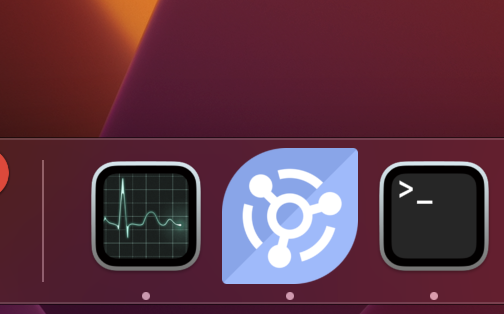
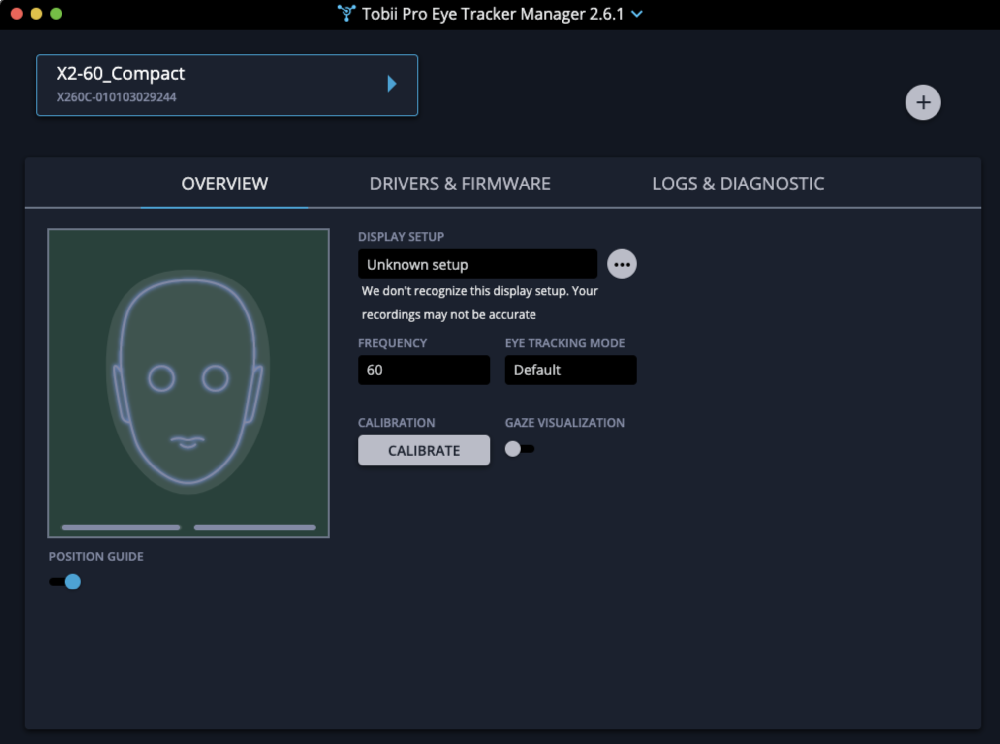
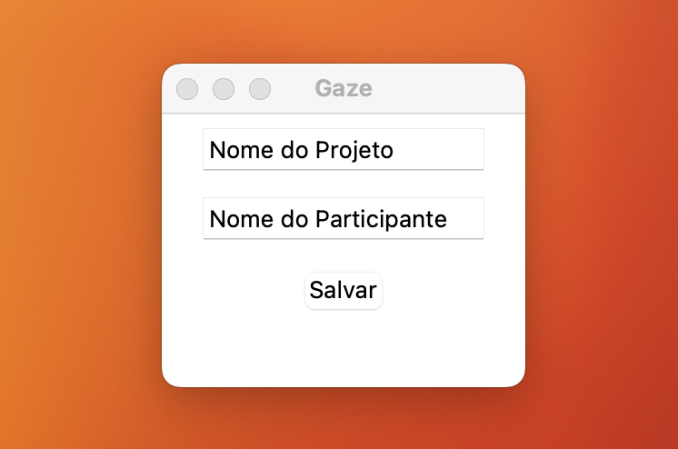
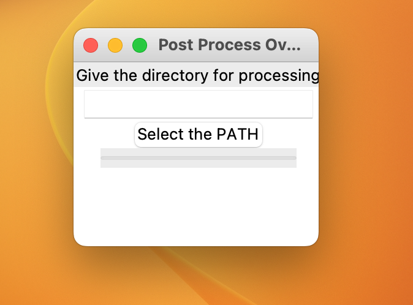
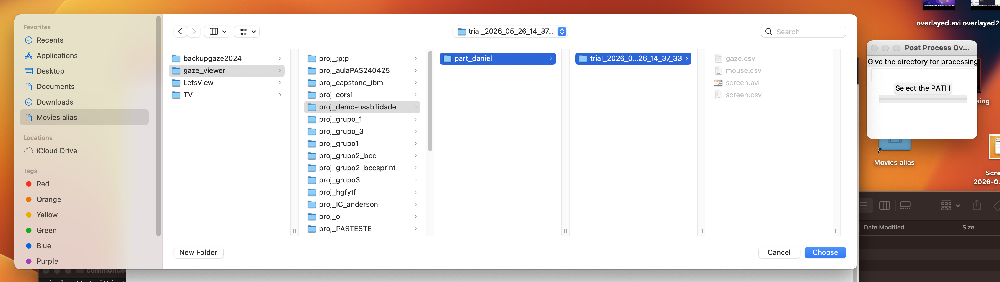
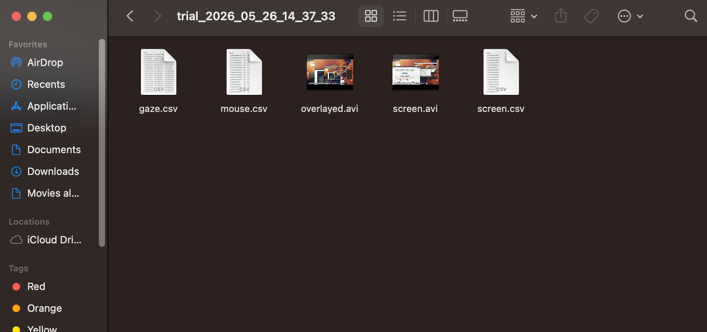
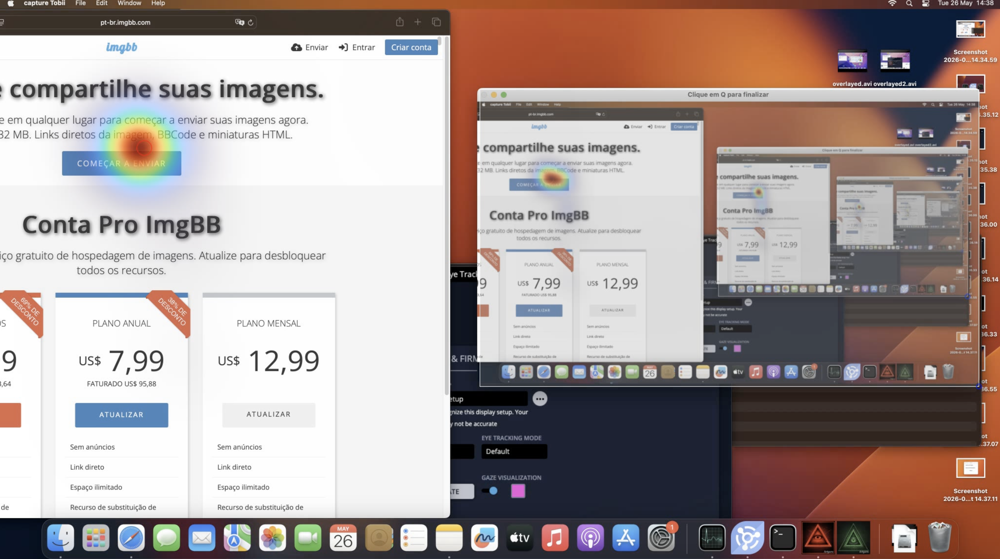

# ⚠️ Aviso

> É obrigatório que HAJA UM TÉCNICO acompanhando diretamente o uso da sala de usabilidade. Não operar os equipamentos sem supervisão técnica.

# Tobii Eye Tracker

Este guia descreve um fluxo de trabalho básico para captura com o Tobii Eye Tracker. Use-o como referência e sempre valide procedimentos com o técnico responsável.

## Configuração e captura

1. Abra o software do Tobii instalado na máquina (ícone em azul) e confirme que o dispositivo está conectado e reconhecido:

   

2. Posicione o participante na frente do monitor. Ajuste a cadeira/altura para que os olhos fiquem alinhados com a zona indicada pelo software.

3. Realize a calibração do participante. Siga o procedimento exibido pelo software (normalmente uma sequência de pontos). Verifique que os indicadores de qualidade (cores/erros) estejam dentro do aceitável:

   

4. Início da gravação com o Capture Tobii

   Abra a aplicação Capture (janela exibida como "Gaze" na imagem abaixo). Antes de iniciar, preencha os campos de metadados da sessão:

   

   - **Nome do Projeto:** nome que agrupa as gravações relacionadas ao mesmo experimento (ex.: "TesteHomepage_v1"). Use um nome curto e descritivo.
   - **Nome do Participante:** identificador único do participante (ex.: "P01", ou iniciais + número). Evite dados pessoais diretamente identificáveis.
   - **Salvar:** grava os metadados da sessão e prepara o sistema para iniciar a captura.

   Após salvar os metadados, confirme a calibração e inicie a gravação no Capture. Verifique o overlay de gaze em tempo real para confirmar que o rastreamento está estável antes de começar a tarefa.

5. Durante a sessão, registre eventos importantes (marcar início/fim de tarefas, comentários do participante) para facilitar a análise posterior:

6. Termine a gravação e salve o projeto. Em alguns fluxos o pós-processamento é feito com a ferramenta "Post Process" — selecione o diretório da sessão e execute o processamento para gerar os arquivos finais (CSV/TSV, vídeos sincronizados, heatmaps):

   

## Visualizando resultados

1. Abra o teste no programa de pós processamento.

   

2. O vídeo final será o overlayed.

   

## Dicas e cuidados

- Tenha sempre um técnico presente para calibrar e monitorar a qualidade dos dados.
- Minimize reflexos e iluminação direta na tela; isso melhora a captura.
- Caso o participante use óculos com reflexo, avalie a qualidade da calibração antes de gravar.
- Mantenha o participante confortável e explique brevemente a tarefa antes de iniciar.
- Sincronize eventos (timestamps) entre o software de estímulo e o Tobii quando for necessário correlacionar interações com gaze.

## Produto final

O produto final costuma incluir um arquivo de gravação com gaze sincronizado, arquivos de dados exportados e visualizações (replay, heatmaps). Abaixo um exemplo de arquivo/processamento final gerado durante análise, neste caso o vídeo overlayed:

---

