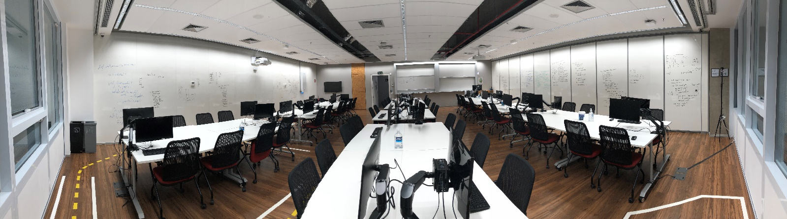
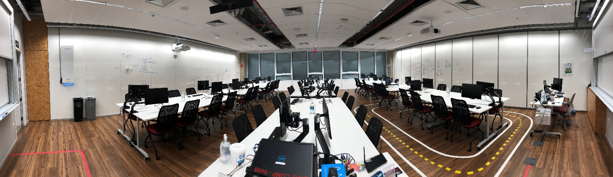
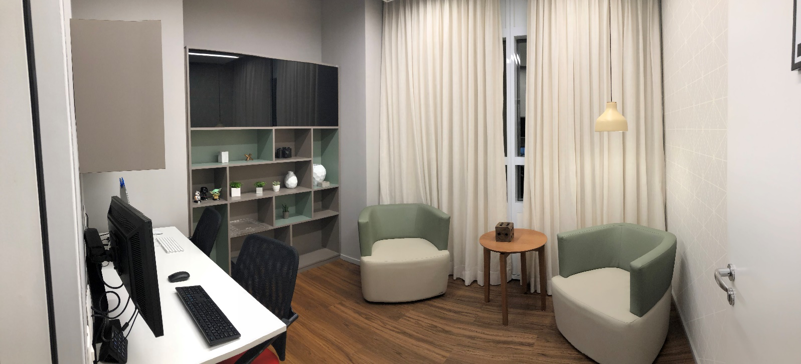

# Orientações gerais dos Laboratórios de Desenvolvimento Ágil e da Sala de Usabilidade

Os Laboratórios de Desenvolvimento Ágil apoiam as disciplinas de Ciência da Computação e Engenharia de Computação do Insper e também atendem alunos e professores de outros cursos mediante solicitação. Os espaços foram projetados para atividades em equipe, desenvolvimento de software, metodologias ágeis e design centrado no usuário.

Estas orientações têm como referência o **Manual Geral de Utilização dos Laboratórios de Desenvolvimento Ágil I/II e Sala de Usabilidade**, de **7 de março de 2025**, versão 2025.1 v1.1. A infraestrutura apresentada corresponde a essa edição; confirme eventuais atualizações com a equipe do laboratório. A coordenação foi atualizada nas informações de contato abaixo.

## Conheça os espaços

### Laboratórios de Desenvolvimento Ágil 1 e 2

O **Ágil 1 fica na sala 412** e o **Ágil 2, na sala 413**. Cada laboratório comporta 60 alunos, totalizando 120. Uma divisória móvel permite separar os ambientes para atividades simultâneas ou integrá-los conforme a necessidade.

As mesas podem ser reorganizadas para diferentes dinâmicas. Cada par de mesas, destinado a quatro alunos, conta com um computador Intel NUC e dois monitores: um conectado ao computador do laboratório e outro destinado ao uso como segunda tela de um notebook pessoal. Cada laboratório dispõe de 15 NUCs para as mesas dos alunos, com 32 GB de RAM e SSD de 480 GB, além de projetores.

### Sala de Usabilidade

A Sala de Usabilidade oferece um ambiente semelhante ao de uma casa para observar a interação dos usuários com interfaces e realizar avaliações qualitativas e quantitativas de software.

A infraestrutura descrita no manual inclui um iMac, um rastreador ocular Tobii Pro X2-60 e quatro câmeras que registram diferentes ângulos da sala. As câmeras ficam atrás de vidros com películas especiais e suas imagens podem ser acompanhadas em monitores externos à sala.

## Quem pode utilizar e para quais atividades

Os espaços atendem alunos e professores em atividades de ensino e projetos, especialmente nas áreas de computação. Entre os objetivos previstos estão:

- Desenvolver capacidades técnicas e projetos de software.
- Aplicar metodologias de desenvolvimento ágil e de design centrado no usuário.
- Desenvolver competências de trabalho em equipe.
- Estudar a interação de usuários com interfaces.

**Não é permitido permanecer no laboratório sem a presença ou a autorização de um técnico ou professor.** O acesso à Sala de Usabilidade deve ser solicitado a um técnico ou professor.

## Reserva e acesso

### Agendamento da Sala de Usabilidade

O agendamento é feito pelo [Microsoft Bookings — Insper Sala de Usabilidade](https://bookings.cloud.microsoft/book/InsperSaladeUsabilidade2@insper.onmicrosoft.com/?ismsaljsauthenabled). A página informa a localização na **Rua Quatá, 200, 4º andar, Sala de Usabilidade**.

Para agendar:

1. Acesse o link e selecione o serviço adequado à atividade.
2. Escolha uma data e um horário disponíveis na agenda.
3. Preencha nome e sobrenome, e-mail e os demais dados solicitados no formulário.
4. Para **Desenvolvimento de Projeto**, descreva o motivo da reserva no campo de observações ou solicitações especiais. A descrição do serviço chama esse campo de “Observações”; no formulário consultado, ele aparece como “Adicionar solicitações especiais”.
5. Leia o aviso sobre tratamento de dados pessoais e os termos de privacidade apresentados. O formulário exige concordância para concluir a inscrição.
6. Confira os dados e clique em **Reservar** para concluir a solicitação.

Na consulta de outubro de 2026, a página apresenta os seguintes serviços:

| Serviço | Duração | Observação |
| --- | --- | --- |
| BCC Eye Tracking | 45 minutos | Selecione a opção correspondente à atividade pretendida. |
| Sprint Sesssion BCC | 1 hora e 30 minutos | Identificado na página como reunião online; confirme com a equipe se sua atividade exige também o uso presencial da sala. |
| Desenvolvimento de Projeto | 1 hora e 30 minutos | Informe o motivo da reserva no campo de observações ou solicitações especiais. |

Os nomes dos serviços acima seguem a página de agendamento. Consulte o Bookings para verificar as opções e a disponibilidade atualizadas. Para dúvidas sobre qual serviço escolher, prazos, alteração ou cancelamento de uma reserva, procure a equipe do laboratório.

O agendamento não substitui a solicitação de acesso à sala a um técnico ou professor.

### Acesso aos laboratórios e aos equipamentos

Para solicitar o uso dos laboratórios Ágil 1 e Ágil 2 ou esclarecer suas condições de acesso, procure um técnico ou professor responsável.

A abertura dos armários e a retirada de equipamentos do laboratório dependem de autorização de um técnico ou professor. Observe também as restrições específicas de cada equipamento descritas abaixo.

## Preparação da atividade

Antes do uso, recomenda-se conferir com a equipe os recursos necessários, a disposição das mesas e o tempo para montagem e testes. Se houver dúvida sobre o manuseio de qualquer equipamento, solicite suporte ao técnico.

Siga as orientações de utilização do manual:

| Recurso | Orientação |
| --- | --- |
| Intel NUC | Os computadores estão fixos no local de uso e não devem ser removidos. Em caso de problemas na inicialização, acione um técnico. |
| Notebooks Dell G7 | Não devem ser removidos do laboratório. São destinados aos postos dos técnicos e às mesas dos professores. |
| Projetores | Utilize com supervisão de um técnico. A conexão pode ser feita por rede ou HDMI. |
| Monitores | O manual orienta o uso com supervisão de um técnico. Os monitores de 23 polegadas destinam-se à segunda tela e possuem cabo HDMI fixo para conexão ao notebook pessoal. |
| Tobii Pro X2-60 e iMac | Utilize com supervisão de um técnico. Os cabos auxiliares já estão conectados. |
| Teclados e mouses | O uso é livre, observadas as regras de acesso ao laboratório. |

Para obter cabos guardados nos armários, solicite auxílio à equipe. O manual não estabelece um procedimento para instalação de programas ou alteração das conexões existentes; consulte um técnico antes de realizar essas mudanças.

## Cuidados durante o uso

- **Não é permitido consumir alimentos no laboratório.**
- **Bebidas somente podem ser consumidas em recipientes com tampa.**
- Utilize as tomadas apenas para equipamentos do laboratório ou fontes de notebooks pessoais.
- **Todas as tomadas do laboratório são de 220 V.** Confira a compatibilidade do equipamento antes de conectá-lo.
- Não abra os armários nem retire equipamentos sem autorização de um técnico ou professor.
- Respeite as restrições de movimentação dos NUCs e dos notebooks Dell G7.
- Em caso de dúvida sobre o uso de um equipamento, solicite suporte ao técnico.

O manual informa que o Insper não se responsabiliza por eventuais consequências da conexão de equipamentos dos alunos aos equipamentos da instituição.

## Arquivos e gravações

O manual descreve os recursos de observação e gravação da Sala de Usabilidade, mas não define procedimentos de consentimento dos participantes, armazenamento, acesso, retenção ou exclusão das gravações. Também não estabelece uma política de armazenamento ou limpeza dos arquivos nos computadores.

Antes de realizar testes com participantes ou gravações, confirme com o professor ou técnico responsável quais procedimentos institucionais devem ser seguidos. Como cuidado prático, mantenha uma cópia dos seus trabalhos em um local próprio e encerre as sessões das suas contas pessoais ao terminar.

## Encerramento da utilização

Como checklist prática de encerramento, recomenda-se:

- [ ] Salvar os trabalhos e conferir a cópia dos arquivos de que precisar.
- [ ] Encerrar as sessões das contas pessoais utilizadas.
- [ ] Devolver à equipe os acessórios e equipamentos recebidos para a atividade.
- [ ] Deixar as mesas organizadas e combinar com a equipe a recomposição do mobiliário, caso tenha sido alterado.
- [ ] Consultar o técnico sobre o desligamento dos equipamentos; o manual não define uma sequência geral de desligamento.

## Problemas, suporte e emergências

Em caso de defeito, dificuldade de uso ou item ausente, procure um técnico ou professor responsável. Para facilitar o atendimento, informe o espaço, o equipamento e o problema observado. Problemas de inicialização dos NUCs devem ser encaminhados a um técnico.

**Em caso de emergência, disque 5416 de qualquer ramal. Em caso de acidente, procure imediatamente o professor ou o técnico, mesmo que nenhum dano pessoal ou material seja percebido.**

Contatos para suporte e coordenação (coordenação atualizada em outubro de 2026; contatos técnicos conforme o manual de março de 2025):

| Responsável | Função | E-mail |
| --- | --- | --- |
| Prof.ª Graziela Simone Tonin | Coordenadora do laboratório | [grazielast@insper.edu.br](mailto:grazielast@insper.edu.br) |
| Daniel Messias da Silva Pinto | Técnico de laboratório | [danielmsp@insper.edu.br](mailto:danielmsp@insper.edu.br) |

## Guias da Sala de Usabilidade

Para consultar a documentação específica disponível no repositório:

- [Infraestrutura da Sala de Usabilidade](Sala-Usabilidade/Infraestrutura.md)
- [Guia do Tobii Eye Tracker](Sala-Usabilidade/TobiiEyeTracker.md)
- [Guia do Pupil Eye Tracker](Sala-Usabilidade/PupilEyeTracker.md)

O Pupil Eye Tracker possui documentação própria no repositório, mas não é descrito no manual geral de março de 2025. Os guias específicos dos laboratórios Ágil 1 e Ágil 2 ainda não estão disponíveis.
